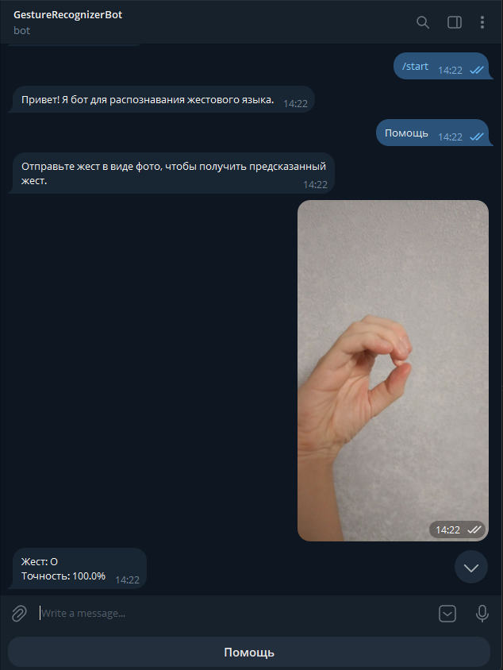
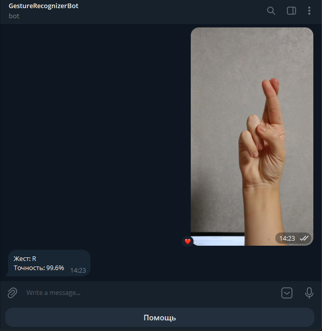

# Распознавание жестового языка с помощью Telegram-бота

Telegram-бот, распознающий жесты языка жестов на фотографиях. В основе лежит дообученная модель ResNet-18 (29 классов: буквы A–Z + `del`, `nothing`, `space`).


## Скриншоты

<div align="center">
  <table>
    <tr>
      <td align="center">
        
        <br/>
        <b>Пример распознавания жеста O</b>
      </td>
      <td align="center">
        
        <br/>
        <b>Пример распознавания жеста R</b>
      </td>
    </tr>
  </table>
</div>

## Содержание
- [О проекте](#распознавание-жестового-языка-с-помощью-telegram-бота)
- [Скриншоты](#скриншоты)
- [Функциональность](#функциональность)
- [Стек технологий](#стек-технологий)
- [Установка и запуск](#установка-и-запуск)
- [Как это работает](#как-это-работает)
- [Структура проекта](#структура-проекта)

## Функциональность
* Отправка фотографий жестов через Telegram
* Классификация жеста по 29 классам (A–Z, `del`, `nothing`, `space`)
* Вывод предсказанного жеста и уверенности модели в процентах
* Кнопка "Помощь" и обработка прочих сообщений

## Стек технологий
* **Бот:** aiogram 3.x, Python 3.12
* **Машинное обучение:** PyTorch, torchvision, PIL
* **Модель:** ResNet-18 (дообученная под 29 классов жестов)

## Установка и запуск

1. Клонирование репозитория
```bash
git clone https://github.com/AlexanderSh11/gesture_recognizer_bot.git
cd gesture_recognizer_bot
```

2. Создание и активация виртуального окружения
```bash
conda create -n gesture_bot python=3.12 -y
conda activate gesture_bot
```

```bash
python -m venv .venv
source .venv/bin/activate # Linux/Mac
.venv\Scripts\activate # Windows
```

3. Установка зависимостей
```bash
pip install -r requirements.txt
```

4. Настройка окружения  
Создайте файл `.env` в корне проекта:
```
BOT_TOKEN=ваш_токен_от_BotFather
```

5. Убедитесь, что файл модели `gesture_model.pth` лежит в корне проекта.

6. Запуск бота
```bash
python bot.py
```

### Возможные сетевые проблемы

`aiogram` поддерживает работу через стандартные прокси-протоколы:

- SOCKS5
- HTTP/HTTPS

Если в вашей сети требуется прокси, укажите его параметры в `.env`:

```
PROXY_HOST=адрес_прокси
PROXY_PORT=порт_прокси
```

Настройка прокси происходит на стороне пользователя. Проект не поставляет и не настраивает прокси; предполагается, что у вас уже есть работающий сетевой доступ к `api.telegram.org` через тот или иной канал.

## Как это работает

### Модель
Класс `SimpleCNN` в `neural_network.py` использует **ResNet-18** без предобученных весов (`weights=None`).

Входные изображения приводятся к размеру **64×64**, нормализуются по среднему и стандартному отклонению `(0.5, 0.5, 0.5)` по каждому каналу.

### Классы жестов
29 классов: буквы `A`–`Z`, а также `del`, `nothing`, `space` (см. `config.py`).

### Логика бота
1. Пользователь отправляет фото жеста.
2. `bot.py` скачивает изображение из Telegram.
3. `GestureRecognizer.predict()` прогоняет картинку через модель и возвращает предсказанный класс + уверенность (`softmax`).
4. Бот отвечает: название жеста и точность в процентах.

## Структура проекта

```
├── bot.py            # Точка входа, логика Telegram-бота  
├── config.py         # Токен бота и словарь классов жестов  
├── neural_network.py # Модель ResNet-18 и класс GestureRecognizer  
├── gesture_model.pth # Веса обученной модели  
├── .env              # BOT_TOKEN  
├── .gitignore  
└── requirements.txt  # Зависимости проекта
```
